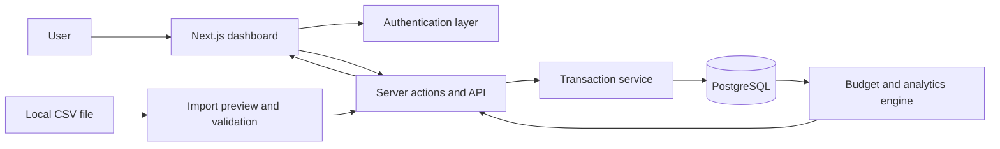

<div align="center">

# VANTAGE

### Personal finance intelligence without giving up control of your data.

**Full stack · Next.js · TypeScript · PostgreSQL · Analytics**

  

[Overview](#overview) · [Features](#planned-capabilities) · [Architecture](#architecture) · [Data & APIs](#data-model-and-api-contract) · [Roadmap](#roadmap)

</div>

---

## Overview

VANTAGE is a privacy-conscious personal finance dashboard that turns imported transactions into useful answers: where money went, whether a budget is on track, and how recurring spending may affect future cash flow. It is designed for **transparent financial analytics**, not investment advice or automatic bank transfers.


---

## Project status

> **Planned · December 2026** — This repository currently contains the product blueprint and planned implementation. Features, security controls, APIs, tests, and performance targets described below are **design goals, not claims of implemented functionality**. Demo links, screenshots and benchmarks will be added only after verification.

## Design principles

- **Local-first and cost-aware:** development should be possible with free/open-source tooling and without paid API subscriptions.
- **Secure by default:** least privilege, explicit trust boundaries, secret redaction, and safe defaults.
- **Reliable by design:** predictable state transitions, useful error messages, idempotent operations where applicable, and observable failures.
- **Honest engineering:** reproducible demos and tests; no fabricated measurements or feature-complete badges.
- **Accessible interfaces:** responsive layouts, keyboard navigation, legible contrast and helpful empty states.


## Planned capabilities

| Capability | Intended behaviour |
| --- | --- |
| Transaction import | Preview, validate and import CSV statements |
| Deduplication | Detect repeat files and repeated transaction records |
| Categories | Assign categories manually or with explainable matching rules |
| Budgets | Define monthly limits and track category progress |
| Analytics | Spending trends, cash flow, income versus expenses and top categories |
| Goals | Set savings targets and show progress over time |
| Forecasts | Estimate future balance using clearly stated assumptions |
| Privacy tools | Export and delete account data, with visible data-retention controls |

## Architecture

The diagram below is a **target architecture** and may evolve through documented architecture decision records (ADRs).



### Core workflow

1. A user signs in to a local or self-hosted instance.
2. They select a CSV, map its columns and preview interpreted dates, amounts and descriptions.
3. Validation flags ambiguous formats and duplicate rows before import.
4. Confirmed records are stored with stable import-batch provenance.
5. User-defined category rules and overrides classify transactions.
6. Budget and analytics queries compute results from authoritative stored values.
7. Forecasts show assumptions, date range and uncertainty instead of promises.

### Proposed technology stack

| Layer | Proposed choice | Rationale |
| --- | --- | --- |
| Application | Next.js + React + TypeScript | Unified frontend and backend development |
| Database | PostgreSQL with migrations | Durable financial records and relational constraints |
| ORM | Prisma or Drizzle (choose after evaluation) | Typed persistence and migrations |
| Auth | Secure session-based authentication | User isolation and safe login flows |
| Charts | Open-source React charting library | Accessible data visualisation |
| Testing | Vitest, Playwright and database tests | Currency math, imports and UI correctness |

## Data model and API contract

The following are **draft entities and endpoint shapes** to guide implementation. They are not deployed APIs.

### Primary data entities

- `users`: `id`, `email`, `password_hash`, `created_at`
- `accounts`: `id`, `user_id`, `name`, `currency`, `type`
- `import_batches`: `id`, `user_id`, `filename_hash`, `imported_at`, `status`
- `transactions`: `id`, `account_id`, `import_batch_id`, `posted_at`, `amount_minor`, `currency`, `description`, `dedupe_key`
- `categories`: `id`, `user_id`, `name`, `parent_id`
- `transaction_categories`: `transaction_id`, `category_id`, `assigned_by`
- `budgets`: `id`, `user_id`, `category_id`, `period_start`, `limit_minor`
- `savings_goals`: `id`, `user_id`, `target_minor`, `target_date`

**Money rule:** store integer minor units (e.g. cents), not binary floating-point amounts. Display currency explicitly and preserve the imported sign convention.

### Planned HTTP interface

```http
POST /api/v1/imports/preview
POST /api/v1/imports/confirm
GET  /api/v1/transactions
PATCH /api/v1/transactions/{id}/category
GET  /api/v1/analytics/summary
GET  /api/v1/budgets
POST /api/v1/budgets
GET  /api/v1/forecast
```

Every endpoint must scope all queries to the authenticated user and validate access to referenced accounts.

## Security and privacy

Use hashed passwords through a vetted auth implementation, secure session cookies, CSRF defenses where applicable, rate limiting and strict per-user row ownership. Never commit real bank statements or financial identifiers. CSV imports must be treated as untrusted input, including spreadsheet formula-injection handling on export. The first release will not require banking credentials or access to live bank APIs.

## User journey

**Planned local workflow (after implementation):** start the application and local database, register a test account, upload a provided fictional CSV statement, preview mappings, confirm import, review categories and charts, add a monthly budget and inspect the forecast assumptions. Published setup instructions will be verified against a clean installation before release.

## Expected repository structure

```text
vantage/
├── src/app/                  # Next.js routes and pages
├── src/components/           # Reusable UI and charts
├── src/server/               # Domain services and secure APIs
├── src/lib/                  # Validation, money and date helpers
├── prisma/ or drizzle/       # Schema and migrations
├── fixtures/                 # Fictional CSV samples
├── tests/                    # Import, money and UI tests
├── docs/                     # Data model and privacy decisions
├── .github/workflows/
└── README.md
```

## Definition of done — first working release

- A fictional CSV can be previewed, validated and imported with no silent loss of records.
- Importing the same file twice does not double-count spending.
- Transactions stay isolated between independent test accounts.
- Budget totals agree exactly with the underlying integer-cent transactions.
- A user can correct categories and see calculations update consistently.
- Forecasts state their assumptions and do not imply guaranteed outcomes.


## Engineering standards

| Area | Standard |
| --- | --- |
| Version control | Small, descriptive commits to `main` during solo development |
| Quality | Linting, formatting, type checks, unit tests and integration tests |
| Documentation | Architecture decisions, API examples, threat model and setup instructions |
| Security | No credentials in Git; dependency review; input validation; least-privilege defaults |
| Demos | Clearly labelled synthetic/fixture data where used; no misleading production claims |
| Budget | R0 target for tools and service subscriptions; cloud deployment is optional |

## Roadmap

- [ ] **Foundation:** repository structure, developer setup, linting and CI
- [ ] **Core:** implement the primary workflow end-to-end with deterministic fixtures
- [ ] **Reliability:** input validation, state/error handling, security controls and automated tests
- [ ] **Experience:** responsive dashboard, accessibility and understandable feedback
- [ ] **Release:** documented local demo, screenshots, reproducible test results and v0.1.0 tag

## Contributing

This is initially a solo portfolio project. Suggestions and thoughtful issues are welcome once development begins. Before opening a pull request, explain the problem, proposed change, tests and any security impact.

## Maintainer

Built by **[Christopher Doyle](https://github.com/Christopher-Doyle)** as part of a four-project December 2026 engineering portfolio series.

## Licence

A licence has **not yet been selected**. Until a licence file is added, please do not assume permission to reuse or redistribute the code. The README and project plan are provided for viewing.
